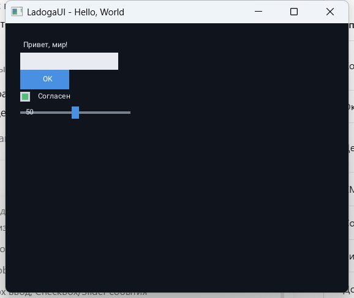

# LadogaUI

Учебный C++ GUI-фреймворк с декларативной XML-разметкой. По именам классов,
свойств и событий он должен быть узнаваем для тех, кто позже откроет Qt или WPF.

Главная цель — не «ещё один GUI-движок», а понятный учебник: студент читает
`<Button Text="OK" Click="onOk"/>` и понимает, что произойдёт. Внутреннее
устройство (парсер, фабрика, маршрутизация событий) вторично и скрыто.

## Статус

**Этапы 1–5 закрыты, этап 6 — документация.** Работает:

- окно SDL3 + OpenGL, цикл событий, закрытие;
- `Widget`, дерево детей, `StackPanel`, `Auto`-размеры и отступы;
- XML-загрузка через pugixml 1.16: тег → класс, атрибут → свойство;
- `Label`, `Button`, `TextBox`, `CheckBox`, `Slider` с текстом;
- клики, фокус TextBox, ввод UTF-8, Backspace, перетаскивание Slider;
- `Click="onOk"` и реестр действий окна;
- текст через stb_truetype + Roboto (кириллица);
- пять примеров: окно, раскладка, XML, события, «Hello, World»;
- шесть тестов: `smoke`, `layout`, `xml`, `events`, `font`, `widgets`.

Не реализованы: `GridPanel`, темы, плагины, установка/упаковка, Linux/РЕД ОС.
Человеческий тест «30 минут» по [Quickstart](docs/QUICKSTART.md) ещё не
проводился — это единственный открытый пункт этапа 6.



## Требования

- C++20;
- CMake 3.24+;
- компилятор: MSVC 2022+, GCC 12+, Clang 15+;
- OpenGL-драйвер;
- интернет при первой сборке: CMake скачивает SDL3 3.4.18 и pugixml 1.16.

Шрифт и `stb_truetype` лежат в `third_party/`, скачивать их отдельно не нужно.
Если SDL3 или pugixml уже установлены в системе, можно собирать с
`-DLADOGA_USE_SYSTEM_SDL3=ON` и `-DLADOGA_USE_SYSTEM_PUGIXML=ON`.

## Сборка

### В CLion

1. Открыть папку `LadogaUI`.
2. `File → Reload CMake Project` (или согласиться на перезагрузку).
3. В списке конфигураций запуска выбрать **ladoga_05_hello** и нажать Run.
4. Для тестов: в терминале CLion выполнить `ctest --test-dir cmake-build-debug --output-on-failure`.

Первая настройка CMake скачивает и собирает SDL3 и pugixml — это занимает несколько минут.
Все примеры и тесты собираются в `<build>/bin`:

```text
ladoga_01_window.exe
ladoga_02_layout.exe
ladoga_03_xml.exe
ladoga_04_events.exe
ladoga_05_hello.exe
ladoga_smoke_test.exe
ladoga_layout_test.exe
ladoga_xml_test.exe
ladoga_events_test.exe
ladoga_font_test.exe
ladoga_widgets_test.exe
```

### В терминале Windows

Если `cmake`, `ninja` и компилятор уже в `PATH`:

```powershell
cmake -S . -B build -G Ninja -DCMAKE_BUILD_TYPE=Debug
cmake --build build
ctest --test-dir build --output-on-failure
.\build\bin\ladoga_05_hello.exe
```

Ожидаемо: окно 560×440 с заголовком `LadogaUI - Hello, World`, текст, поле
ввода, кнопка OK, флажок и слайдер. Введите имя и нажмите OK — приветствие
изменится. Окно закрывается крестиком, процесс завершается с кодом 0.

На этой машине компилятора в `PATH` нет, поэтому можно временно добавить
инструменты, встроенные в CLion:

```powershell
$clion = "C:\Programming\Apps\JetBrains\CLion 2026.2.4.1"
$env:PATH = "$clion\bin\cmake\win\x64\bin;$clion\bin\ninja\win\x64;$clion\bin\mingw\bin;$env:PATH"
cmake -S . -B build -G Ninja -DCMAKE_BUILD_TYPE=Debug
cmake --build build
ctest --test-dir build --output-on-failure
.\build\bin\ladoga_05_hello.exe
```

### В терминале Linux / macOS

```bash
cmake -S . -B build -G Ninja -DCMAKE_BUILD_TYPE=Debug
cmake --build build
ctest --test-dir build --output-on-failure
./build/bin/ladoga_05_hello
```

## Структура

```text
LadogaUI/
├── CMakeLists.txt          сборка ядра, примеров и тестов
├── PROJECT_BRIEF.md        исходный бриф проекта — источник истины
├── AGENTS.md               правила для ИИ-агента и точка входа в проект
├── cmake/Dependencies.cmake SDL3, OpenGL, pugixml
├── third_party/            stb_truetype.h, Roboto, лицензии
├── include/ladoga/         публичный API (то, что видит студент)
│   ├── ladoga.h            единый заголовок
│   ├── application.h       точка входа
│   ├── widget.h            база дерева и события
│   ├── window.h            окно, load_from_xml, действия
│   ├── stack_panel.h       вертикальная/горизонтальная панель
│   ├── label.h, button.h, text_box.h, check_box.h, slider.h
│   ├── renderer.h          абстракция рисования
│   └── core/               геометрия, цвет, отступы, события
├── src/
│   ├── app/                Application и цикл событий
│   ├── render/             SDL3Backend, OpenGLRenderer, Font
│   ├── xml/                XmlLoader, WidgetFactory, PropertyMap
│   └── widget.cpp, stack_panel.cpp, window.cpp, виджеты
├── examples/               01_window … 05_hello
├── tests/                  smoke, layout, xml, events, font, widgets
└── docs/
    ├── API_CONTRACT.md     контракт имён, свойств и событий
    ├── API_REFERENCE.md    справочник классов и методов
    ├── XML_REFERENCE.md    синтаксис разметки
    ├── ARCHITECTURE.md     внутренние границы модулей
    ├── ROADMAP.md          этапы 0–8
    ├── PLAN.md             план из маленьких шагов
    ├── QUICKSTART.md       быстрый старт за 30 минут
    ├── EXAMPLES.md         описание пяти примеров
    ├── TROUBLESHOOTING.md  частые ошибки
    └── widgets/            Label, Button, TextBox, CheckBox, Slider
```

## Документация

- [Быстрый старт за 30 минут](docs/QUICKSTART.md)
- [Справочник API](docs/API_REFERENCE.md)
- [Справочник по XML](docs/XML_REFERENCE.md)
- [Примеры](docs/EXAMPLES.md)
- [Справочник по виджетам](docs/widgets/README.md)
- [Частые проблемы](docs/TROUBLESHOOTING.md)
- [Контракт API](docs/API_CONTRACT.md)
- [Архитектура](docs/ARCHITECTURE.md)
- [Дорожная карта](docs/ROADMAP.md)
- [Подробный план](docs/PLAN.md)
- [Исходный бриф](PROJECT_BRIEF.md)

## Правила проекта

1. Публичный API и документация первичны; внутренности можно упрощать.
2. Не добавлять сети, базы данных, многопоточность и сложные анимации.
3. Каждый новый виджет сопровождается примером и страницей справки.
4. При конфликте «красиво» и «понятно студенту» выбирать второе.
5. Временные упрощения помечать комментарием `// TODO: упрощение для этапа N`.
