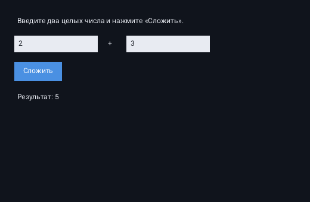

# Практикум: «Сумма двух чисел» — от подключения фреймворка до запуска

LadogaUI — учебный GUI-фреймворк с XML-разметкой. В этом практикуме мы пройдём
путь целиком: подключим фреймворк к **отдельному** CMake-проекту, создадим окно,
опишем в XML два текстовых поля и кнопку, напишем обработчик, который складывает
`a` и `b`, и выведем результат в `Label`. Каждый шаг объяснён: зачем нужна
команда, что она делает и что произойдёт, если её убрать.

Время: 20–30 минут у человека, который уже собирал C++-проекты CMake. Первая
сборка дольше обычного: CMake скачивает и собирает SDL3 и pugixml.

Готовый пример в репозитории: [`examples/06_sum`](../examples/06_sum).



## Что должно получиться

- окно 520×340 с заголовком `LadogaUI — Сумма двух чисел`;
- два `TextBox` с начальными значениями `2` и `3`;
- кнопка «Сложить»;
- `Label` «Результат: —», который после нажатия показывает «Результат: 5»;
- сообщение об ошибке, если в поле ввели не целое число;
- около 100 строк C++ и 13 строк XML.

## 1. Как устроен LadogaUI: три идеи, без которых не понять код

### 1.1 Retained mode: виджеты — это объекты, которые живут всё время

В LadogaUI, как в Qt Widgets и WPF, дерево виджетов создаётся один раз и живёт до
закрытия окна. `Window` владеет детьми (`std::unique_ptr`), каждый виджет хранит
свои свойства (`Text`, `Width`, `Name`). Каждый кадр приложение обходит дерево:
сначала раскладка, потом события, потом рисование. Поэтому когда вы вызываете
`label.set_text("…")`, картинка обновится в следующем кадре сама — перерисовку
просить не нужно.

### 1.2 XML — это то же дерево, только записанное текстом

Правило фреймворка одно и очень короткое:

| В XML | Во фреймворке |
|---|---|
| тег | C++-класс: `<Button>` → `ladoga::Button` |
| атрибут | свойство класса: `Text="OK"` → `set_text("OK")` |
| вложенность | дети виджета: `<StackPanel>…</StackPanel>` |
| `Name` | адрес виджета для `find_child<T>("…")` |
| `Click="onSum"` | имя действия, зарегистрированного в окне |

Тег `Window` — корень, у него один обязательный уровень вложенности. Всё, что
внутри, — обычные виджеты.

### 1.3 События и действия: XML не знает C++

В XML нельзя написать лямбду. Вместо этого кнопка получает **имя действия**:
`Click="onSum"`. Окно хранит реестр действий `std::map<std::string,
std::function<void()>>`. В C++ вы регистрируете действие с тем же именем:

```cpp
register_action("onSum", [this] { onSum(); });
```

При клике кнопка вызывает `invoke_action("onSum")`, окно находит лямбду и
выполняет её. Если имя не зарегистрировано, в `stderr` появится сообщение
`действие 'onSum' не зарегистрировано`, а приложение продолжит работу.

### 1.4 Один кадр приложения

`Application::run(window)` устроен так (упрощённо, по `src/app/application.cpp`):

1. создать нативное окно SDL3 и контекст OpenGL по заголовку и размеру `Window`;
2. в цикле: узнать размер клиентской области и передать его окну;
3. `window.layout()` — разложить детей по размерам и отступам;
4. забрать события SDL и передать каждое в `window.dispatch_event(event)`;
5. `window.paint(renderer)` — нарисовать дерево;
6. показать кадр; выйти из цикла, когда окно закрыто.

Отсюда два следствия, важных для практики:

- `set_text` достаточно: следующий кадр сам нарисует новый текст;
- `load_from_xml` надо вызвать **до** `run`: размеры окна из XML нужны при
  создании нативного окна.

### 1.5 Словарь для тех, кто знает Qt или WPF

| LadogaUI | Qt | WPF |
|---|---|---|
| `Widget` | `QWidget` | `FrameworkElement` |
| `Window` | `QMainWindow` | `Window` |
| `StackPanel` | `QVBoxLayout` / `QHBoxLayout` | `StackPanel` |
| `Label` | `QLabel` | `Label` |
| `Button` | `QPushButton` | `Button` |
| `TextBox` | `QLineEdit` | `TextBox` |
| `clicked` | сигнал `clicked` | событие `Click` |

## 2. План работы

| Шаг | Что делаем | Файл | Проверяем |
|---|---|---|---|
| 0 | собираем и проверяем сам фреймворк | — | `ctest` — 6 из 6 |
| 1 | создаём отдельный проект и подключаем фреймворк | `CMakeLists.txt` | CMake настраивается |
| 2 | запускаем пустое окно | `main.cpp` | окно открывается и закрывается |
| 3 | описываем форму | `main.xml` | XML создан (загрузится на шаге 4) |
| 4 | загружаем XML, подключаем кнопку | `main.cpp` | виджеты видны, клик вызывает `onSum` |
| 5 | разбираем числа и складываем | `main.cpp` | 2 + 3 = 5 |
| 6 | собираем, запускаем, проверяем сценарии | — | поведение как на скриншоте |

## 3. Шаг 0. Подготовка

### 3.1 Требования

| Компонент | Версия / примечание |
|---|---|
| C++ | C++20 |
| CMake | 3.24 и новее |
| Компилятор | MSVC 2022+, GCC 12+ или Clang 15+ |
| OpenGL | рабочий драйвер видеокарты |
| Интернет | при первой настройке CMake скачает SDL3 3.4.18 и pugixml 1.16 |
| Шрифт | `Roboto-Regular.ttf` уже лежит в `third_party/` фреймворка |

### 3.2 Соберите и проверьте фреймворк

Прежде чем подключать LadogaUI к своему проекту, убедитесь, что он собирается
сам по себе. В каталоге `LadogaUI`:

```powershell
cmake -S . -B build -G Ninja -DCMAKE_BUILD_TYPE=Debug
cmake --build build
ctest --test-dir build --output-on-failure
```

Ожидаемо: `100% tests passed, 0 tests failed out of 6`. Затем запустите готовый
пример, чтобы увидеть, что окно и шрифт работают:

```powershell
.\build\bin\ladoga_05_hello.exe
```

Если в вашей среде нет `cmake`, `ninja` и компилятора в `PATH`, используйте
инструменты CLion (пути подставьте свои):

```powershell
$clion = "C:\Programming\Apps\JetBrains\CLion 2026.2.4.1"
$env:PATH = "$clion\bin\cmake\win\x64\bin;$clion\bin\ninja\win\x64;$clion\bin\mingw\bin;$env:PATH"
```

### 3.3 Разложите каталоги

Удобно держать фреймворк и свой проект рядом:

```text
C:\Projects\
├── LadogaUI\          репозиторий фреймворка (его не копируем, не правим)
└── sum_app\           наш проект
    ├── CMakeLists.txt
    ├── main.cpp
    └── main.xml
```

Путь без пробелов и кириллицы избавит от части сюрпризов компилятора и CMake.
Если пути с пробелами всё же есть — в CMake просто всегда берите путь в кавычки.

## 4. Шаг 1. Подключение фреймворка

### 4.1 CMakeLists.txt

Создайте `sum_app/CMakeLists.txt`:

```cmake
cmake_minimum_required(VERSION 3.24)
project(sum_app LANGUAGES CXX)

set(CMAKE_CXX_STANDARD 20)
set(CMAKE_CXX_STANDARD_REQUIRED ON)
set(CMAKE_CXX_EXTENSIONS OFF)

# 1. Где лежит репозиторий LadogaUI.
#    Путь можно переопределить при настройке: -DLADOGA_ROOT=C:/...
set(LADOGA_ROOT "${CMAKE_CURRENT_SOURCE_DIR}/../LadogaUI"
    CACHE PATH "Каталог исходников LadogaUI")

# 2. Не собирать примеры и тесты фреймворка внутри нашего проекта.
set(LADOGA_BUILD_EXAMPLES OFF)
set(LADOGA_BUILD_TESTS OFF)

# 3. Подключить фреймворк. Второй аргумент — имя каталога сборки внутри
#    нашего build; он создаётся автоматически.
add_subdirectory("${LADOGA_ROOT}" ladoga)

# 4. Наша программа. Цель Ladoga::ladoga приносит заголовки и зависимости.
add_executable(sum_app main.cpp)
target_link_libraries(sum_app PRIVATE Ladoga::ladoga)

# 5. Абсолютный путь к XML. Не зависит от того, из какого каталога запущен exe.
target_compile_definitions(sum_app PRIVATE
    APP_XML_PATH="${CMAKE_CURRENT_SOURCE_DIR}/main.xml"
)

# 6. Windows + MinGW: положить рядом с exe DLL рантайма.
#    Без них exe не запустится на машине без MinGW в PATH.
if(MINGW)
    target_link_options(sum_app PRIVATE -static-libgcc -static-libstdc++)
    get_filename_component(mingw_bin "${CMAKE_CXX_COMPILER}" DIRECTORY)
    add_custom_command(TARGET sum_app POST_BUILD
        COMMAND ${CMAKE_COMMAND} -E copy_if_different
            "${mingw_bin}/libwinpthread-1.dll"
            "$<TARGET_FILE_DIR:sum_app>"
        VERBATIM
    )
endif()
```

### 4.2 Что делает каждая строка

| Строка | Смысл |
|---|---|
| `cmake_minimum_required(VERSION 3.24)` | Минимальная версия CMake. Меньше 3.24 фреймворк не поддерживает. |
| `project(sum_app LANGUAGES CXX)` | Имя проекта и языки. C++ — единственный обязательный. |
| `set(CMAKE_CXX_STANDARD 20)` | Стандарт C++. Фреймворк требует C++20 и передаёт это требование через `Ladoga::ladoga` (`target_compile_features(ladoga PUBLIC cxx_std_20)`); явная строка просто дублирует его для наглядности. |
| `set(LADOGA_ROOT … CACHE PATH …)` | Путь к исходникам фреймворка. `CACHE PATH` позволяет переопределить его через `-D` и хранит значение в `CMakeCache.txt`. |
| `set(LADOGA_BUILD_EXAMPLES OFF)` | Обычная переменная **до** `add_subdirectory`. Фреймворк объявляет эти опции через `option()`, а `option()` не перезаписывает уже заданную переменную. Так мы не собираем чужие примеры и тесты. |
| `add_subdirectory("${LADOGA_ROOT}" ladoga)` | Подключает фреймворк как подпроект. Первый аргумент — каталог с его `CMakeLists.txt`, второй — каталог сборки подпроекта. Для источника вне дерева нашего проекта второй аргумент обязателен: без него CMake прерывает конфигурацию с ошибкой про отсутствующий binary directory. |
| `add_executable(sum_app main.cpp)` | Наша программа. |
| `target_link_libraries(… Ladoga::ladoga)` | Ссылка на цель фреймворка. Вместе с ней приходят публичные заголовки (`include/ladoga`), стандарт C++20 и зависимости SDL3/pugixml/OpenGL. |
| `target_compile_definitions(… APP_XML_PATH=…)` | Зашивает путь к XML в бинарник как строковый макрос. Подробности — в шаге 4. |
| `if(MINGW) … -static-libgcc -static-libstdc++` | Убирает зависимость от `libgcc_s_seh-1.dll` и `libstdc++-6.dll`. Фреймворк делает так же для своих целей. |
| копирование `libwinpthread-1.dll` | Последняя DLL, которая остаётся динамической; кладём её рядом с exe. |

> Почему не `find_package(LadogaUI)`? На этапе 6 у фреймворка нет правил
> `install()` и упаковки. Единственный поддерживаемый способ подключения —
> `add_subdirectory` (или `FetchContent`, если фреймворк лежит в Git). SDL3 и
> pugixml фреймворк скачивает сам, отдельно ставить их не нужно.

### 4.3 Первая настройка и сборка

Из каталога `sum_app`:

```powershell
cmake -S . -B build -G Ninja -DCMAKE_BUILD_TYPE=Debug
cmake --build build
```

Что произойдёт:

1. CMake прочитает `LadogaUI/CMakeLists.txt` и `cmake/Dependencies.cmake`;
2. `FetchContent` скачает SDL3 3.4.18 и pugixml 1.16 (нужен интернет);
3. соберутся `pugixml`, `SDL3` и статическая библиотека `ladoga`;
4. соберётся `build/sum_app.exe` (Windows) или `build/sum_app` (Linux/macOS).

Первая сборка занимает несколько минут. Повторная — секунды: меняется только
ваш `main.cpp`.

В CLion: откройте папку `sum_app`, согласитесь на перезагрузку CMake, выберите
цель `sum_app` и нажмите Run.

> Если `ninja` в вашей среде недоступен или ведёт себя странно, используйте
> генератор `MinGW Makefiles` и ту же команду сборки:
> `cmake -S . -B build -G "MinGW Makefiles" -DCMAKE_BUILD_TYPE=Debug`.
> На поведение приложения это не влияет.

### 4.4 Почему exe должен лежать рядом с DLL (Windows + MinGW)

Если собрать внешний проект MinGW без флагов `-static-libgcc -static-libstdc++`,
Windows при запуске попросит `libgcc_s_seh-1.dll`, `libstdc++-6.dll` и
`libwinpthread-1.dll`. Их нет в `PATH` у обычного пользователя, поэтому exe
завершится с кодом `0xC0000135` (не найдена DLL). Блок `if(MINGW)` в CMake
решает проблему: две библиотеки линкуются статически, одна копируется рядом с
exe. Именно поэтому фреймворк в своих примерах делает то же самое.

С MSVC и на Linux/macOS этот блок не нужен.

> Во фреймворке есть готовая функция `ladoga_copy_mingw_runtime(target)`. В
> практикуме выше оставлен явный блок, чтобы было видно, что именно копируется.
> Функция теперь самодостаточна: вычисляет путь от `CMAKE_CXX_COMPILER` и
> работает после `add_subdirectory` из внешнего проекта.

### 4.5 Шрифт

Фреймворк ищет `Roboto-Regular.ttf` в таком порядке: путь, зашитый при сборке
(LADOGA_FONT_PATH — абсолютный путь к `third_party/` фреймворка), затем
`<каталог exe>/fonts/Roboto-Regular.ttf`, затем `third_party/` от текущего
каталога, затем системные шрифты. Пока репозиторий фреймворка лежит на диске,
текст будет рисоваться. Цель `ladoga_fonts` копирует шрифт в `<build>/bin/fonts`
(для внешнего проекта это корень его сборки); для запуска эта копия не нужна,
потому что срабатывает первый путь — абсолютный `LADOGA_FONT_PATH` из каталога
исходников фреймворка. Если вы переносите готовый exe на другую машину,
положите шрифт в `fonts/Roboto-Regular.ttf` рядом с exe.

## 5. Шаг 2. Пустое окно

Создайте `main.cpp`:

```cpp
#include <exception>
#include <iostream>

#include <ladoga/ladoga.h>

int main(int argc, char** argv) {
    try {
        ladoga::Application app(argc, argv);
        ladoga::Window window("LadogaUI — Сумма двух чисел", 520, 340);
        return app.run(window);
    } catch (const std::exception& error) {
        std::cerr << "LadogaUI: " << error.what() << '\n';
        return 1;
    }
}
```

Разберём каждую строку:

1. `#include <ladoga/ladoga.h>` — единый заголовок фреймворка. Он подключает
   `Application`, `Window`, все виджеты и базовые типы. Отдельные заголовки
   (`<ladoga/window.h>` и т. п.) тоже существуют, но для учебного кода удобнее
   один.
2. `int main(int argc, char** argv)` — обычная точка входа. `argc`/`argv`
   передаются в `Application`; сейчас они зарезервированы под будущие параметры
   командной строки, но сигнатура уже как у обычного приложения.
3. `try { … } catch (const std::exception&)` — `Application` и загрузка XML
   могут выбросить исключение (нет OpenGL, неверный XML). Без `catch`
   приложение молча упадёт; с `catch` вы увидите причину.
4. `ladoga::Application app(argc, argv);` — создаёт объект приложения. Сам по
   себе конструктор ничего не инициализирует: SDL3, контекст OpenGL и нативное
   окно создаются внутри `run`. Объект должен жить, пока работает цикл событий,
   поэтому он создаётся в `main` до `run`.
5. `ladoga::Window window("LadogaUI — Сумма двух чисел", 520, 340);` — корневое
   окно: заголовок и размеры. Параметры необязательны: по умолчанию
   `"LadogaUI"`, 800×600.
6. `return app.run(window);` — создаёт нативное окно, запускает цикл событий и
   возвращает `0`, когда окно закрыто. Пока цикл работает, `run` не
   возвращается — это нормально.
7. `return 1` в `catch` — код ошибки процесса.

Соберите и запустите:

```powershell
cmake --build build
.\build\sum_app.exe
```

Ожидаемо: тёмное окно 520×340 с заголовком, которое закрывается крестиком.
Текста внутри нет — это следующий шаг.

## 6. Шаг 3. Форма в XML

### 6.1 main.xml

Создайте `sum_app/main.xml`:

```xml
<?xml version="1.0" encoding="UTF-8"?>
<Window Name="SumWindow" Title="LadogaUI — Сумма двух чисел" Width="520" Height="340">
    <StackPanel Orientation="Vertical" Margin="24">
        <Label Name="hint" Text="Введите два целых числа и нажмите «Сложить»." />
        <StackPanel Orientation="Horizontal" Margin="0 12 0 0">
            <TextBox Name="boxA" Width="140" Text="2" />
            <Label Name="plus" Text="+" Margin="12 2 12 0" />
            <TextBox Name="boxB" Width="140" Text="3" />
        </StackPanel>
        <Button Name="sumButton" Text="Сложить" Click="onSum" Margin="0 16 0 0" />
        <Label Name="result" Text="Результат: —" Margin="0 16 0 0" />
    </StackPanel>
</Window>
```

### 6.2 Четыре правила чтения разметки

1. **Тег — это класс.** `<TextBox>` создаёт `ladoga::TextBox`.
2. **Атрибут — это свойство.** `Text="2"` вызывает `set_text("2")`.
3. **Вложенность — это дети.** Два `TextBox` и `Label` лежат в горизонтальной
   панели, панель — в вертикальной, вертикальная — в окне.
4. **`Name` — это адрес.** По нему C++ находит виджет: `find_child<TextBox>("boxA")`.
   Без `Name` виджет существует, но достучаться до него из кода нельзя.

### 6.3 `<Window>` — корень

| Атрибут | Тип | По умолчанию | Что делает |
|---|---|---|---|
| `Name` | строка | пусто | имя окна; не обязательно |
| `Title` | строка | `LadogaUI` | заголовок нативной оконной рамки |
| `Width` | целое или `Auto` | 800 | ширина клиентской области |
| `Height` | целое или `Auto` | 600 | высота клиентской области |
| `Margin` | отступ | 0 | отступы корневого контейнера |
| `Visible` | `true` / `false` | `true` | при `false` содержимое не рисуется и не принимает события; само окно остаётся на экране |

Важно: `load_from_xml` **не создаёт второе окно**. Он настраивает уже
существующий объект `Window` (в нашем коде — `SumWindow`) и добавляет ему детей.
Поэтому `Title`, `Width` и `Height` из XML перекрывают значения, переданные в
конструктор, — размер нативного окна берётся уже после загрузки XML.

Корневой тег обязан быть `<Window>`: если написать `<Form>`, загрузка упадёт с
ошибкой `корневой тег должен быть <Window>`.

### 6.4 `<StackPanel>` — контейнер

`StackPanel` расставляет детей в одном направлении:

- `Orientation="Vertical"` (по умолчанию) — сверху вниз;
- `Orientation="Horizontal"` — слева направо.

Алгоритм простой: берём верхний левый угол панели, отсчитываем `Margin` ребёнка,
ставим ребёнка, сдвигаем курсор на его высоту плюс отступы, повторяем. Размер
ребёнка берётся из `Width`/`Height`, а если там `Auto` — из `preferred_size()`
виджета.

Из этого следуют три практических вывода:

1. панель **не растягивает** детей по ширине и не центрирует их — поэтому у
   `TextBox` в разметке явно указан `Width="140"`;
2. порядок детей в XML = порядок на экране;
3. внешние отступы (`Margin`) применяются снаружи виджета и входят в расчёт
   позиции следующего ребёнка.

В нашем XML две панели: внешняя вертикальная (все строки формы) и внутренняя
горизонтальная (поле `a`, плюс, поле `b`). Вложенность панелей — обычный способ
строить формы; `GridPanel` в этой версии фреймворка ещё не реализован.

### 6.5 `<Label>` — текст только для чтения

| Атрибут | Значение | Смысл |
|---|---|---|
| `Text` | строка | отображаемый текст |
| `Name` | строка | адрес для `find_child<Label>` |

`Label` не принимает ввод, не переносит строки и пока не умеет выравнивать текст
по правому краю или центру. Высота по умолчанию — 24 px, ширина — по тексту
(минимум 24 px), если не задан `Width`. Текст рисуется светлым цветом на тёмном
фоне.

`Name="hint"` у первой подсказки не используется из C++, но это хорошая
привычка: позже подсказку можно менять из обработчика.

### 6.6 `<TextBox>` — однострочный ввод

| Атрибут | Значение | Смысл |
|---|---|---|
| `Text` | строка | начальное содержимое |
| `Width` | целое или `Auto` | ширина поля; при `Auto` — не меньше 160 px |
| `Height` | целое или `Auto` | высота; по умолчанию 28 px |
| `Name` | строка | адрес для `find_child<TextBox>` |

Что важно знать о поведении:

- клик по полю ставит фокус; клавиатурный ввод идёт в поле с фокусом;
- ввод добавляется в конец строки, `Backspace` удаляет последний символ
  (корректно и для UTF-8, то есть для кириллицы);
- `Enter` поглощается полем и ничего не делает — «кнопки по умолчанию» пока нет;
- `TextBox` принимает **любые** печатные символы: буквы, пробелы, знаки. Он не
  знает, что вы ждёте число, — проверка будет в C++ (шаг 5);
- выделения текста, стрелок и позиционирования курсора мышью в этой версии нет:
  курсор всегда в конце строки;
- `text_changed` вызывается только при пользовательском вводе; программный
  `set_text` его не вызывает.

### 6.7 `<Button>` — кнопка

| Атрибут | Значение | Смысл |
|---|---|---|
| `Text` | строка | надпись на кнопке |
| `Click` | строка | **имя действия** (не код!) |
| `Name` | строка | адрес для `find_child<Button>` |
| `Width` / `Height` | целое или `Auto` | размер; при `Auto` — минимум 80×32 px |

`Click="onSum"` при загрузке XML превращается в обработчик кнопки, который
вызывает `Window::invoke_action("onSum")`. Само действие регистрируется в C++
(шаг 4). Клик засчитывается, только если нажатие **и** отпускание произошли
внутри кнопки; нажали и увели мышь — `clicked` не сработает.

### 6.8 Общие атрибуты всех виджетов

| Атрибут | Значение | Примечание |
|---|---|---|
| `Name` | строка | уникален в пределах окна; дубликат — ошибка загрузки |
| `Width` | целое ≥ 0 или `Auto` | `Auto` — размер по содержимому |
| `Height` | целое ≥ 0 или `Auto` | то же по вертикали |
| `Margin` | 1 число или 4 числа | снаружи виджета, только ≥ 0 |
| `Visible` | `true` / `false` | невидимый виджет не рисуется и не ловит клики |
| `Text` | строка | только `Label`, `Button`, `TextBox`, `CheckBox` |

Форматы значений:

- целые числа без единиц: `Width="400"`, `Margin="16"`;
- `Margin="16"` — со всех сторон; `Margin="16 8 16 8"` — `left top right bottom`;
- `Visible` и `Checked` — строго `true` или `false` в нижнем регистре;
- строки — UTF-8, всегда в двойных кавычках;
- регистр тегов и атрибутов важен: `<Button>`, а не `<button>`; `Text`, а не
  `text`.

### 6.9 Ошибки разметки

Загрузчик не игнорирует незнакомое молча — он сообщает файл, строку и колонку:

```text
main.xml:2:2: корневой тег должен быть <Window>
main.xml:6:14: неизвестный тег <Buton>
main.xml:6:14: неизвестный атрибут 'Tex'
main.xml:8:14: Name 'boxA' уже используется
```

Позиции соответствуют файлу из §6.1: загрузчик указывает начало имени тега,
поэтому у вложенных элементов колонка больше, чем у корня.

Это главный инструмент отладки XML: опечатка в теге или атрибуте видна сразу и
с точным местом.

### 6.10 Разметка строка за строкой

| Строка / элемент | Что происходит |
|---|---|
| `<?xml …?>` | объявление XML и кодировки; не тег виджета |
| `<Window …>` | настраивает существующее окно: имя, заголовок, размер |
| `<StackPanel Orientation="Vertical" Margin="24">` | вертикальный контейнер с отступом 24 px от краёв окна |
| `<Label Name="hint" …/>` | подсказка сверху, высотой 24 px |
| `<StackPanel Orientation="Horizontal" Margin="0 12 0 0">` | строка ввода: сверху отступ 12 px, дети слева направо |
| `<TextBox Name="boxA" Width="140" Text="2" />` | поле `a`: ширина 140 px, начальный текст «2» |
| `<Label Name="plus" Text="+" Margin="12 2 12 0" />` | знак «+»: отступы 12 px по бокам, 2 px сверху — чтобы выровнять с полями высотой 28 px |
| `<TextBox Name="boxB" Width="140" Text="3" />` | поле `b` |
| `</StackPanel>` | конец строки ввода |
| `<Button … Click="onSum" Margin="0 16 0 0" />` | кнопка; `Click` связывает её с действием `onSum`; 16 px сверху |
| `<Label Name="result" … Margin="0 16 0 0" />` | результат; `result` понадобится из C++ |
| `</StackPanel>` | конец вертикального контейнера |
| `</Window>` | конец документа |

## 7. Шаг 4. Загружаем XML и подключаем кнопку

### 7.1 Класс окна

Теперь нам нужен класс, который умеет загрузить XML и найти в нём виджеты.
Наследуемся от `ladoga::Window`:

```cpp
#include <filesystem>
#include <string>

#include <ladoga/ladoga.h>

#ifndef APP_XML_PATH
#error "APP_XML_PATH не задан: добавьте target_compile_definitions в CMakeLists.txt"
#endif

class SumWindow final : public ladoga::Window {
public:
    SumWindow() {
        load_from_xml(std::filesystem::path(APP_XML_PATH));
        register_action("onSum", [this] { onSum(); });
    }

    ladoga::TextBox& boxA() { return *find_child<ladoga::TextBox>("boxA"); }
    ladoga::TextBox& boxB() { return *find_child<ladoga::TextBox>("boxB"); }
    ladoga::Label& result() { return *find_child<ladoga::Label>("result"); }

private:
    void onSum() {
        result().set_text("Кнопка нажата");
    }
};
```

В `main` вместо `ladoga::Window` создаём `SumWindow`:

```cpp
int main(int argc, char** argv) {
    try {
        ladoga::Application app(argc, argv);
        SumWindow window;
        return app.run(window);
    } catch (const std::exception& error) {
        std::cerr << "LadogaUI: " << error.what() << '\n';
        return 1;
    }
}
```

### 7.2 `load_from_xml`

```cpp
load_from_xml(std::filesystem::path(APP_XML_PATH));
```

- читает файл и строит дерево детей окна;
- повторный вызов **заменяет** дерево целиком (старые дети удаляются);
- применяет атрибуты корня `<Window>` к текущему объекту: `Title`, `Width`,
  `Height` и т. д.;
- при ошибке бросает `std::runtime_error` с путём, строкой и колонкой;
- файл не найден — исключение `не удалось открыть файл`.

Путь `APP_XML_PATH` зашит в бинарник на этапе компиляции (см. шаг 1). Почему так,
а не просто `"main.xml"`? Потому что относительный путь ищется от **текущего
рабочего каталога**, а он у CLion, проводника и терминала разный. Абсолютный путь
из макроса работает всегда, пока исходники на месте.

Второй способ — положить `main.xml` рядом с exe и задать
`APP_XML_PATH="main.xml"`. При запуске двойным щелчком текущим каталогом будет
каталог exe, и всё найдётся; но при запуске из терминала или CLion из другого
каталога приложение не найдёт XML и завершится с ошибкой
`main.xml: не удалось открыть файл`. Поэтому в учебном проекте оставляем
абсолютный путь. Для переноса готового приложения копируйте и exe, и `main.xml`
(и запускайте из их каталога) либо замените путь на абсолютный.

### 7.3 `register_action` и `Click`

```cpp
register_action("onSum", [this] { onSum(); });
```

- `register_action` кладёт пару «имя → функция» в реестр действий окна
  (`std::map<std::string, std::function<void()>>`);
- `std::function` умеет хранить лямбду, поэтому синтаксис короткий;
- `[this]` захватывает окно: обработчик вызывает его метод `onSum`;
- имя в C++ и в XML должно совпадать **посимвольно**: `onSum` и `onsum` — разные
  действия;
- регистрировать можно после загрузки XML: ссылки `Click` проверяются не при
  загрузке, а при клике. Если действие забыли — в `stderr` будет сообщение, окно
  останется живым.

Порядок в конструкторе (`load_from_xml`, затем `register_action`) не критичен,
но так читается естественнее: сначала форма, потом её поведение.

### 7.4 `find_child<T>`

```cpp
ladoga::TextBox& boxA() { return *find_child<ladoga::TextBox>("boxA"); }
```

- `find_child` обходит дерево от окна вниз и ищет виджет с `Name="boxA"`;
- шаблонная версия сразу приводит результат к нужному типу через
  `dynamic_cast<T*>`;
- если имя не найдено или тип другой, вернётся `nullptr`; разыменование
  `nullptr` — падение. В учебном коде мы уверены в XML, но в реальном проекте
  стоит проверять:

  ```cpp
  auto* box = find_child<ladoga::TextBox>("boxA");
  if (box == nullptr) {
      throw std::runtime_error("в XML нет TextBox с Name=\"boxA\"");
  }
  ```

- аксессоры `boxA()`, `boxB()`, `result()` прячут `find_child` и делают код
  обработчика коротким. Это не магия: каждый вызов — обход дерева, но дерево
  маленькое, и вызов происходит только по клику.

### 7.5 `text()` и `set_text()`

- `TextBox::text()` возвращает `const std::string&` — текущее содержимое;
- `Label::set_text(std::string)` заменяет текст;
- `Button::text()` и `Button::set_text()` — надпись на кнопке;
- изменение свойства не требует перерисовки: `Application::run` рисует дерево
  каждый кадр, поэтому новый текст появится в следующем кадре.

Проверка шага: соберите проект, запустите, нажмите «Сложить» — внизу должно
появиться «Кнопка нажата». Если нет:

- в XML опечатка в `Click` или `Name` — смотрите сообщения загрузчика;
- действие не зарегистрировано — в консоли `действие 'onSum' не зарегистрировано`;
- кнопка не реагирует — нажимайте и отпускайте внутри её прямоугольника.

## 8. Шаг 5. Считаем сумму

### 8.1 Текст — не число

`TextBox::text()` возвращает строку. Пользователь может ввести `abc`, пустую
строку или `12x`. `std::stoi` в такой ситуации либо бросит исключение, либо
молча вернёт `12` из `"12x"` — второй вариант особенно опасен. Нужен разбор
строки **целиком**, и в C++20 для этого есть `std::from_chars`.

### 8.2 `parse_int`

Добавьте в `main.cpp` перед классом окна:

```cpp
#include <charconv>
#include <optional>
#include <system_error>

namespace {

/// Разбирает строку целиком как целое число.
/// "" / "abc" / " 42" / "42x" / переполнение -> std::nullopt.
std::optional<int> parse_int(const std::string& text) {
    if (text.empty()) {
        return std::nullopt;
    }
    int value = 0;
    const char* begin = text.data();
    const char* end = begin + text.size();
    const auto [ptr, error] = std::from_chars(begin, end, value);
    if (error != std::errc{} || ptr != end) {
        return std::nullopt;
    }
    return value;
}

} // namespace
```

Что происходит:

- `std::from_chars` — стандартная функция C++17/20, разбирает число без
  исключений и без выделения памяти;
- `begin`/`end` — границы строки; `from_chars` **не** пропускает пробелы и не
  требует завершающего `\0`;
- `error != std::errc{}` — ошибка разбора: не цифры, переполнение `int`;
- `ptr != end` — разобрана только часть строки (`"12x"`), значит, это не число;
- `std::optional<int>` — «число или ничего»: вызывающий код обязан проверить
  результат и не может случайно использовать мусор.

### 8.3 Обработчик `onSum`

Замените тело `onSum`:

```cpp
void onSum() {
    const std::optional<int> a = parse_int(boxA().text());
    const std::optional<int> b = parse_int(boxB().text());
    if (!a || !b) {
        result().set_text("Ошибка: оба поля должны содержать целое число");
        return;
    }
    // Сумма двух int может не поместиться в int, поэтому считаем в long long.
    const long long sum = static_cast<long long>(*a) + static_cast<long long>(*b);
    result().set_text("Результат: " + std::to_string(sum));
}
```

Разбор:

1. читаем оба поля и сразу разбираем их;
2. `if (!a || !b)` — хотя бы одно поле не число: показываем ошибку и выходим.
   Ранний выход делает основную логику плоской, без вложенных `if`;
3. `*a` и `*b` безопасны только после проверки `has_value` — это гарантирует
   `if` выше;
4. `long long` — чтобы `2000000000 + 2000000000` не переполнило `int` (в C++
   переполнение знакового `int` — неопределённое поведение);
5. `std::to_string` превращает число обратно в строку;
6. `"Результат: " + ...` — конкатенация `std::string` и `std::string`.

### 8.4 Полный `main.cpp`

```cpp
#include <charconv>
#include <exception>
#include <filesystem>
#include <iostream>
#include <optional>
#include <string>
#include <system_error>

#include <ladoga/ladoga.h>

#ifndef APP_XML_PATH
#error "APP_XML_PATH не задан: добавьте target_compile_definitions в CMakeLists.txt"
#endif

namespace {

/// Разбирает строку целиком как целое число; пустая строка/мусор — ошибка.
std::optional<int> parse_int(const std::string& text) {
    if (text.empty()) {
        return std::nullopt;
    }
    int value = 0;
    const char* begin = text.data();
    const char* end = begin + text.size();
    const auto [ptr, error] = std::from_chars(begin, end, value);
    if (error != std::errc{} || ptr != end) {
        return std::nullopt;
    }
    return value;
}

} // namespace

class SumWindow final : public ladoga::Window {
public:
    SumWindow() {
        load_from_xml(std::filesystem::path(APP_XML_PATH));
        register_action("onSum", [this] { onSum(); });
    }

    ladoga::TextBox& boxA() { return *find_child<ladoga::TextBox>("boxA"); }
    ladoga::TextBox& boxB() { return *find_child<ladoga::TextBox>("boxB"); }
    ladoga::Label& result() { return *find_child<ladoga::Label>("result"); }

private:
    void onSum() {
        const std::optional<int> a = parse_int(boxA().text());
        const std::optional<int> b = parse_int(boxB().text());
        if (!a || !b) {
            result().set_text("Ошибка: оба поля должны содержать целое число");
            return;
        }
        // Сумма двух int может не поместиться в int.
        const long long sum = static_cast<long long>(*a) + static_cast<long long>(*b);
        result().set_text("Результат: " + std::to_string(sum));
    }
};

int main(int argc, char** argv) {
    try {
        ladoga::Application app(argc, argv);
        SumWindow window;
        return app.run(window);
    } catch (const std::exception& error) {
        std::cerr << "LadogaUI: " << error.what() << '\n';
        return 1;
    }
}
```

### 8.5 Что здесь главное

| Блок | Роль |
|---|---|
| `#include <ladoga/ladoga.h>` | публичный API фреймворка |
| `#error` | понятная ошибка сборки, если забыли макрос пути к XML |
| `parse_int` | граница «строка → число»; единственное место, где вводится доверие к вводу |
| `class SumWindow : public Window` | форма: загрузка XML, действия, доступ к виджетам |
| `load_from_xml` | XML → дерево виджетов |
| `register_action` | `Click="onSum"` → вызов метода |
| `find_child<T>` + аксессоры | типизированный доступ к `TextBox`/`Label` по `Name` |
| `onSum` | бизнес-логика: проверить, сложить, показать |
| `main` | `Application` + `run` + обработка исключений |

## 9. Шаг 6. Сборка, запуск, проверка

### 9.1 Команды

```powershell
cmake --build build
.\build\sum_app.exe
```

В CLion: цель `sum_app` → Run.

### 9.2 Что вы увидите

Окно как на скриншоте в начале (там кнопка уже нажата и показан результат 5).
При первом запуске в нижней строке — «Результат: —»; подсказка, поля с `2` и `3`
и кнопка «Сложить» на месте. Нажмите «Сложить» — появится «Результат: 5».

Проверьте сценарии:

| Действие | Ожидаемый результат |
|---|---|
| `2` и `3` → «Сложить» | `Результат: 5` |
| `-7` и `10` → «Сложить» | `Результат: 3` |
| очистить `a` (Backspace) → «Сложить» | `Ошибка: оба поля должны содержать целое число` |
| ввести `abc` → «Сложить» | та же ошибка |
| ввести `12x` → «Сложить» | та же ошибка (строка не разобрана целиком) |
| `2000000000` + `2000000000` | `Результат: 4000000000` (спасибо `long long`) |
| клик по полю, ввод кириллицы | символы появляются; как число не принимаются |
| закрыть окно крестиком | процесс завершается с кодом 0 |

### 9.3 Что происходит при нажатии кнопки

1. SDL3 получает системное сообщение мыши и превращает его в `Event`;
2. `Application::run` передаёт событие в `Window::dispatch_event`;
3. окно делает hit-test: находит самый глубокий видимый виджет под курсором —
   это `Button`;
4. `MouseDown` запоминает кнопку и снимает фокус с `TextBox` (кнопка фокус не
   принимает);
5. `MouseUp` внутри кнопки вызывает `clicked`, а тот — `invoke_action("onSum")`;
6. окно находит зарегистрированную лямбду и вызывает `SumWindow::onSum`;
7. `onSum` читает `text()` обоих полей, разбирает числа и вызывает
   `result().set_text(...)`;
8. в следующем кадре `paint` рисует `Label` с новым текстом.

Обратите внимание на шаг 4: после нажатия кнопки фокус снимается. Чтобы снова
печатать, кликните в нужное поле — это особенность текущей версии, а не ошибка
вашего кода.

### 9.4 XML можно менять без пересборки C++

`load_from_xml` читает файл при запуске. Если поправить `main.xml` (например,
`Text="7"` у `boxB`) и просто перезапустить exe, изменения появятся — C++
пересобирать не нужно. Это удобно для подбора отступов и подписей. Если же вы
поменяли `Name` или `Click`, не забудьте синхронизировать C++: строки в
`find_child` и `register_action` должны совпадать с XML.

### 9.5 Код возврата и закрытие

`app.run` возвращает `0` после закрытия окна. Если XML не загрузился, исключение
поймает `catch`, напечатает причину и вернёт `1`. Для GUI-подсистемы (без
консоли) `stderr` не виден — см. следующий раздел.

## 10. Опыт: что даёт фреймворк и что стоит учесть

Впечатления от первого прохода:

- **API маленький.** Для формы хватило `Application`, `Window`, `StackPanel`,
  `Label`, `TextBox`, `Button` и пяти методов (`load_from_xml`,
  `register_action`, `find_child`, `text`, `set_text`). Для сравнения, в Qt или
  WPF на такую форму уходит больше «церемоний».
- **XML — это и есть дизайнер.** Разметка читается почти как HTML; подписи,
  отступы и структуру можно править без перекомпиляции C++.
- **Ошибки разметки точные.** Сообщения вида `main.xml:9:9: Name 'boxA' уже
  используется` экономят время: не нужно искать, где сломалась форма.
- **Два языка — один контракт.** XML отвечает за внешний вид, C++ — за
  поведение; связывает их `Name` и `Click`. Если переименовали `Name` в XML,
  C++ этого не заметит до запуска.
- **Нет data binding.** Значения полей не «привязываются» к переменным: вы
  сами читаете строки в обработчике и сами проверяете их. Для учебного проекта
  это плюс — видно, где происходит преобразование.
- **Ограничения честные.** Нет `GridPanel`, тем, переноса строк, `Enter` как
  «нажать кнопку», выделения текста. Всё это вынесено в следующие этапы, а не
  «забыто».

## 11. Необязательно: убрать консольное окно на Windows

По умолчанию проект собирается как консольное приложение: вместе с окном
открывается консоль, зато видны `stderr` и сообщения об ошибках. Чтобы получить
обычное GUI-приложение, нужны два изменения.

**CMake:** сделать цель GUI-подсистемой.

```cmake
if(WIN32)
    set_target_properties(sum_app PROPERTIES WIN32_EXECUTABLE TRUE)
endif()
```

**C++:** у GUI-подсистемы Windows точкой входа служит `WinMain`, а не `main`.
Вынесите запуск в функцию и добавьте обёртку:

```cpp
#if defined(_WIN32)
#include <windows.h>
#endif

namespace {

void report_error(const std::exception& error) {
#if defined(_WIN32)
    MessageBoxA(nullptr, error.what(), "LadogaUI", MB_ICONERROR | MB_OK);
#else
    std::cerr << "LadogaUI: " << error.what() << '\n';
#endif
}

} // namespace

int run_app() {
    try {
        ladoga::Application app(0, nullptr);
        SumWindow window;
        return app.run(window);
    } catch (const std::exception& error) {
        report_error(error);
        return 1;
    }
}

#if defined(_WIN32)
int WINAPI WinMain(HINSTANCE, HINSTANCE, LPSTR, int) { return run_app(); }
#else
int main() { return run_app(); }
#endif
```

Почему так: `WIN32_EXECUTABLE TRUE` на MinGW добавляет `-mwindows`, линкер ищет
`WinMain`, а консольное окно не создаётся. `MessageBoxA` заменяет `stderr`,
которого в GUI-приложении не видно. Ровно этот приём используют примеры
фреймворка (`examples/gui_main.h`).

Если оставить `WIN32_EXECUTABLE TRUE` и обычный `main`, на MSVC сборка упадёт на
этапе линковки (`LNK2019`: не найден `WinMain`). На MinGW-w64 такая комбинация
может собраться и даже запуститься, потому что CRT подставляет обёртку, но
полагаться на это не стоит: поведение зависит от версии toolchain. Явный
`WinMain` переносим и предсказуем.

## 12. Ограничения текущей версии (этап 6)

| Чего нет | Следствие для этой формы |
|---|---|
| data binding, выражений в атрибутах | читаем `text()` и разбираем числа вручную |
| `GridPanel` | раскладка только `StackPanel`; поля не выравниваются по сетке |
| тем, стилей, цветов в XML | цвета фиксированные |
| `Enter` как «нажать кнопку» | после ввода нужно кликнуть кнопку |
| выделения и стрелок в `TextBox` | курсор всегда в конце строки |
| переноса строк и выравнивания `Label` | подписи в одну строку, по левому краю |
| `install()` / `find_package` | подключение только через `add_subdirectory` |
| нескольких окон в одном XML | одно окно на файл |

## 13. Упражнения

1. **Разность.** Добавьте вторую кнопку `Text="Вычесть"` с `Click="onSub"`,
   зарегистрируйте `onSub` и посчитайте `a - b`. Убедитесь, что два действия
   живут в одном окне независимо.
2. **Красивый вывод.** Покажите не только сумму, но и выражение:
   `2 + 3 = 5`. Строку соберите через `std::to_string`.
3. **Живой пересчёт.** Назначьте в конструкторе
   `boxA().text_changed = [this](const std::string&) { onSum(); };` и то же для
   `boxB()`. Кнопка останется, но результат будет обновляться при вводе.
   Помните: `set_text` из кода `text_changed` не вызывает.
4. **Очистка.** Добавьте кнопку «Очистить» с `Click="onClear"` и обработчиком,
   который делает `boxA().set_text("")`, `boxB().set_text("")` и
   `result().set_text("Результат: —")`.
5. **Заголовок.** В `onSum` добавьте
   `set_title("Сумма: " + std::to_string(sum));` — заголовок окна обновится в
   следующем кадре.
6. **Своя ошибка.** Замените текст ошибки на подсказку с примером:
   `«Введите целые числа, например 2 и 3»`.

## 14. Справочник по тому, что использовано

### 14.1 XML

| Тег | Атрибуты в этом примере | Назначение |
|---|---|---|
| `Window` | `Name`, `Title`, `Width`, `Height` | корень, настройка окна |
| `StackPanel` | `Orientation`, `Margin` | контейнер: вертикальный и горизонтальный |
| `Label` | `Name`, `Text`, `Margin` | текст только для чтения |
| `TextBox` | `Name`, `Width`, `Text` | однострочный ввод |
| `Button` | `Name`, `Text`, `Click`, `Margin` | кнопка и имя действия |

Полный список атрибутов и правил — в [XML_REFERENCE.md](XML_REFERENCE.md).

### 14.2 C++ API

| Метод | Где | Что делает |
|---|---|---|
| `Application(argc, argv)` | `main` | создаёт объект приложения; SDL3/OpenGL инициализируются в `run` |
| `Application::run(Window&)` | `main` | создаёт окно, крутит цикл, возвращает код |
| `Window(title, width, height)` | конструктор `SumWindow` (неявно) | заголовок и размер по умолчанию |
| `Window::load_from_xml(path)` | `SumWindow` | строит дерево детей из XML |
| `Window::register_action(name, fn)` | `SumWindow` | связывает `Click="…"` с лямбдой |
| `Window::set_title(string)` | обработчик (упражнение 5) | меняет заголовок окна |
| `Widget::find_child<T>(name)` | аксессоры | ищет виджет по `Name` с приведением типа |
| `TextBox::text()` / `set_text()` | `onSum` | чтение и запись содержимого поля |
| `Label::set_text()` | `onSum` | вывод результата |
| `std::from_chars` | `parse_int` | строгий разбор числа (стандартная библиотека) |

### 14.3 Поток события

```text
SDL3 → Event → Window::dispatch_event → hit-test
     → Button::on_event → clicked → invoke_action("onSum")
     → SumWindow::onSum → Label::set_text → следующий кадр paint
```

## 15. Частые ошибки

| Симптом | Причина | Что делать |
|---|---|---|
| `main.xml:…: не удалось открыть файл` | неверный `APP_XML_PATH` | проверьте значение макроса и что XML существует |
| `неизвестный тег <Buton>` | опечатка | сверить с [XML_REFERENCE.md](XML_REFERENCE.md), регистр важен |
| `неизвестный атрибут 'Tex'` | опечатка в свойстве | `Text`, не `Tex` |
| `Name 'boxA' уже используется` | два виджета с одним `Name` | имена уникальны в пределах окна |
| клик по кнопке ничего не делает | нет действия или опечатка в имени | `register_action("onSum", …)` и `Click="onSum"` должны совпадать |
| в консоли `действие '…' не зарегистрировано` | забыли `register_action` | добавить регистрацию |
| `find_child` вернул `nullptr` / падение при клике | `Name` в XML не совпадает с C++ | сверить строки |
| текст не рисуется | не найден шрифт | проверить `third_party/Roboto-Regular.ttf`; положить `fonts/Roboto-Regular.ttf` рядом с exe |
| exe не запускается, `0xC0000135` | нет DLL MinGW | включить блок `if(MINGW)` из шага 1 |
| после кнопки ввод не идёт | кнопка сняла фокус | кликнуть в поле ввода |
| `Enter` не нажимает кнопку | не реализовано | нажать кнопку мышью |
| открывается консоль | консольная подсистема | см. раздел 11 |

## 16. Чек-лист

- [ ] фреймворк собирается, `ctest` — 6 из 6;
- [ ] `sum_app` настраивается CMake без ошибок;
- [ ] пустое окно 520×340 открывается и закрывается;
- [ ] XML загружается, поля, плюс и кнопка видны;
- [ ] клик по кнопке вызывает `onSum`;
- [ ] `2 + 3` даёт `5`;
- [ ] пустое поле и `abc` дают понятную ошибку;
- [ ] окно закрывается с кодом 0;
- [ ] понятно, за что отвечает каждый тег и атрибут в `main.xml`;
- [ ] понятно, как добавить вторую кнопку и второе действие.

## Ссылки

- [Быстрый старт](QUICKSTART.md)
- [Справочник API](API_REFERENCE.md)
- [Справочник по XML](XML_REFERENCE.md)
- [Справочник по виджетам](widgets/README.md)
- [Частые проблемы](TROUBLESHOOTING.md)
- Готовый пример: [`examples/06_sum`](../examples/06_sum)
